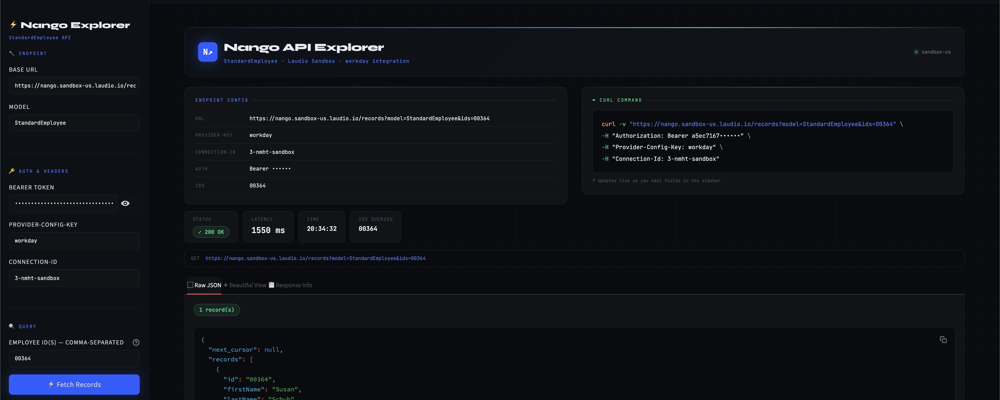

# Nango API Explorer

A Streamlit web app to query the Nango records API interactively, for any model (Company, CostCenter, StandardEmployee, …).

## Setup

```bash
pip install -r requirements.txt
cp .env.example .env   # then fill in your values
```

### `.env` format

`.env` is git-ignored. Settings are keyed by **environment** and **client**:

| Key | Meaning |
| --- | --- |
| `<ENV>_NANGO_BASE_URL`, `<ENV>_NANGO_BEARER_TOKEN` | Records endpoint and token per environment (`SANDBOX_GLOBAL`, `SANDBOX_US`, `DEV`, `STG`, `PROD`) |
| `<CLIENT>_NANGO_CONNECTION_ID`, `<CLIENT>_NANGO_PROVIDER_CONFIG_KEY` | Connection and provider per client, e.g. `GEI1_NANGO_CONNECTION_ID` |

Any `<CLIENT>_NANGO_CONNECTION_ID` entry automatically appears in the Client dropdown.

## Run

```bash
streamlit run app.py
```

Then open <http://localhost:8501> in your browser.





## Features

- **Environment / Client / Model dropdowns** — the environment sets the base URL and bearer token, the client sets the Connection-Id and Provider-Config-Key (a dropdown with a custom option), all loaded from `.env` into editable fields; **Save to .env** writes edits back
- **Glass UI with dark / light mode** — toggle ☀️ Light mode in the sidebar; styling lives in `styles.css`
- **Optional IDs** — leave empty to fetch all records, or enter comma-separated IDs
- **Large outputs** — page size (`limit`) with **Next page** cursor paging, a filterable sortable **Table** view, paginated **Cards**, and a truncated **Raw JSON** preview with full download
- **Live cURL preview** — see the exact curl command (token masked)
- **Response Info tab** — status, latency, size, request metadata
